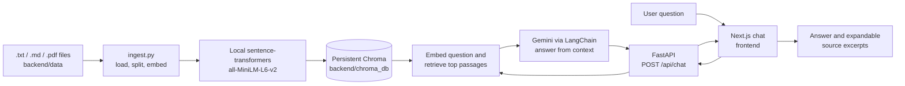

# Asterion Assist — Local RAG Chatbot

A simple, full-stack Retrieval-Augmented Generation (RAG) example. Ask questions about the fictional Asterion Works company and get answers based on the included company documents, with the retrieved document excerpts shown as sources.

> **Important:** The company, products, prices, and policies in this workshop are fictional. The chatbot requires a Gemini API key to generate answers. The key stays in the backend and must never be placed in frontend code or a `NEXT_PUBLIC_` variable.

## What is RAG?

**RAG** means **Retrieval-Augmented Generation**. It combines looking up relevant information with a language model that can explain it:

1. **Prepare the knowledge:** Split the company documents into smaller passages and create a numerical embedding for each passage. An embedding is a list of numbers that represents the meaning of text.
2. **Find relevant passages:** When someone asks a question, embed the question and search the local vector database for passages with similar meaning.
3. **Generate a grounded answer:** Send only those selected passages and the question to Gemini. The model writes an answer based on that context.
4. **Show the evidence:** Return the source filenames and passages alongside the answer so a person can check what it used.

In plain language: **RAG looks through your documents first, then asks the AI to answer from the best matching parts.** It does not send the entire document collection for every question. The prompt tells the model to say when the documents do not contain an answer and to treat document text as reference material, not as instructions.

## How this project works



### Request lifecycle

- The browser sends `{ "question": "..." }` to the FastAPI backend.
- The backend validates the question and searches the ingested Chroma collection.
- LangChain formats the retrieved excerpts into a prompt and calls the configured Gemini model.
- The backend returns an answer and source records with `filename`, `chunk_id`, and `content`.
- The frontend renders the answer and lets the user expand each source excerpt.

Embeddings run locally on CPU. Gemini is the only hosted model service in the answer path; the browser never receives its API key.

## What is included?

```text
Rag Bot/
├── README.md
├── backend/
│   ├── data/
│   │   ├── company_guide.md
│   │   ├── company_profile.txt
│   │   ├── employee_policies.txt
│   │   ├── products_and_support.txt
│   │   └── it_security.txt
│   ├── chroma_db/                 # Generated local index; ignored by Git
│   ├── .env                       # Local secrets; ignored by Git
│   ├── .env.example               # Safe environment-variable template
│   ├── .gitignore
│   ├── requirements.txt
│   ├── main.py                    # FastAPI API and server entry point
│   ├── rag.py                     # Load, chunk, embed, retrieve, and answer
│   └── ingest.py                  # Command-line document ingestion
└── frontend/
    ├── app/
    │   ├── globals.css            # Responsive interface styling
    │   ├── layout.tsx             # Root layout and page metadata
    │   └── page.tsx               # Interactive chat, API call, citations
    ├── .env.local.example         # Safe frontend API URL template
    ├── .gitignore
    ├── package.json
    └── package-lock.json
```

The four `.txt` files are the fictional knowledge base: company history, employee policies, products and customer support, and IT security. The Markdown guide explains which document covers each topic. `.md` and text-based `.pdf` documents placed under `backend/data/` are also supported. Image-only PDFs are not OCR-processed.

## Technology and packages

### Backend Python packages

The backend dependencies are listed in [`backend/requirements.txt`](./backend/requirements.txt). Install them using pip from the backend environment.

| Package | What it does here |
| --- | --- |
| `fastapi` | Defines the HTTP API, validates request data, and returns JSON responses. |
| `uvicorn[standard]` | Runs the FastAPI application as a local web server. |
| `langchain` | Provides the orchestration framework for retrieval-augmented generation. |
| `langchain-core` | Provides shared LangChain documents, prompts, and runnable components. |
| `langchain-community` | Supplies document loaders, including text and PDF loaders. |
| `langchain-text-splitters` | Breaks long documents into overlapping passages suitable for retrieval. |
| `langchain-chroma` | Connects LangChain to the persistent local Chroma vector store. |
| `langchain-huggingface` | Connects LangChain to the local Hugging Face embedding model. |
| `langchain-google-genai` | Connects LangChain to Gemini for answer generation. |
| `sentence-transformers` | Loads `sentence-transformers/all-MiniLM-L6-v2` to embed text locally. |
| `chromadb` | Stores document chunks and embeddings on disk and performs similarity search. |
| `python-dotenv` | Loads backend configuration from `backend/.env`. |
| `pypdf` | Extracts text and page metadata from PDF files. |

### Frontend packages

The frontend dependencies are listed in [`frontend/package.json`](./frontend/package.json).

| Package | What it does here |
| --- | --- |
| `next` | Runs the web app, App Router, local development server, and production build. |
| `react` | Builds the interactive chat interface and manages its UI state. |
| `react-dom` | Renders the React interface in the browser. |
| `typescript` | Checks the frontend's types before build and during development. |
| `eslint` | Finds common code-quality and correctness issues. |
| `eslint-config-next` | Provides Next.js-specific ESLint rules. |
| `tailwindcss` | Provides the CSS processing foundation used by the application styles. |
| `@tailwindcss/turbopack` | Integrates Tailwind CSS processing with the configured Turbopack build. |
| `@types/node`, `@types/react`, `@types/react-dom` | Provide TypeScript declarations for Node.js and React APIs. |

The browser uses the standard Fetch API for the backend request; no extra HTTP client is needed.

## Prerequisites

- Python 3.11 recommended (Python 3.10 or later)
- Node.js 20 or later and npm
- A Gemini API key with access to the configured model
- Network access on first ingestion to download the embedding model

## Run locally

Open a terminal at the project root for each set of commands below.

### 1. Set up the backend

```powershell
cd backend
py -3.11 -m venv .venv
.\.venv\Scripts\Activate.ps1
python -m pip install --upgrade pip
python -m pip install -r requirements.txt
if (-not (Test-Path .env)) { Copy-Item .env.example .env }
```

Edit `backend/.env` and replace the example `GOOGLE_API_KEY` value with your own key. Do not commit `.env` or share the key. `GEMINI_MODEL` defaults to `gemini-2.5-flash`; change it in `.env` if your key has access to a different supported model.

### 2. Ingest the knowledge documents

From the `backend/` directory, with its virtual environment active:

```powershell
python ingest.py
```

The first run downloads and loads the local embedding model, then reports the document and chunk counts. Chroma data is stored under `backend/chroma_db/`, which is generated locally and ignored by Git.

Ingestion can be rerun whenever files are added or updated. It discovers supported documents recursively, records source metadata, uses deterministic chunk IDs to avoid duplicate records, and prunes outdated chunks once the current documents have been stored. Unsupported file types are logged and skipped. An empty folder or unreadable supported document fails with an error instead of creating a successful-looking empty index.

### 3. Start the backend

Still from `backend/`:

```powershell
python main.py
```

The API runs at `http://127.0.0.1:8000`. To enable automatic reload during development:

```powershell
python -m uvicorn main:app --host 127.0.0.1 --port 8000 --reload
```

### 4. Start the frontend

Open another terminal at the project root:

```powershell
cd frontend
npm install
if (-not (Test-Path .env.local)) { Copy-Item .env.local.example .env.local }
npm run dev
```

Visit `http://localhost:3000`. `NEXT_PUBLIC_API_URL` defaults to `http://localhost:8000`. If the backend uses another URL, change this value in `frontend/.env.local`, then restart the Next.js dev server. Never put the Gemini key in a `NEXT_PUBLIC_` variable.

## Environment settings

Backend settings live in `backend/.env`; the safe template is `backend/.env.example`.

| Setting | Purpose | Default |
| --- | --- | --- |
| `GOOGLE_API_KEY` | Secret Gemini API key used only by the backend. | No key; configure it locally. |
| `GEMINI_MODEL` | Gemini model used to generate responses. | `gemini-2.5-flash` |
| `EMBEDDING_MODEL` | Hugging Face embedding model name. | `sentence-transformers/all-MiniLM-L6-v2` |
| `CHROMA_DIR` | Local persistent Chroma storage directory. | `./chroma_db` |
| `DATA_DIR` | Input document directory. | `./data` |
| `TOP_K` | Maximum number of similar document chunks retrieved per question. | `4` |
| `BACKEND_HOST` | Host interface used by `python main.py`. | `127.0.0.1` |
| `BACKEND_PORT` | Port used by `python main.py`. | `8000` |
| `CORS_ORIGINS` | Comma-separated browser origins permitted by the API. | `http://localhost:3000,http://127.0.0.1:3000` |

Relative backend paths are resolved from the backend folder, so run `python ingest.py` and `python main.py` from `backend/`. Frontend settings live in `frontend/.env.local`.

## API basics

| Method and path | Purpose |
| --- | --- |
| `GET /` | Returns a basic service status. |
| `GET /health` | Returns service status and whether a local index is initialized; never includes secrets. |
| `POST /api/chat` | Retrieves relevant text and returns a Gemini answer with source excerpts. |

Example request:

```http
POST http://localhost:8000/api/chat
Content-Type: application/json
```

```json
{
  "question": "What are the WattWatch Pro price and warranty period?"
}
```

Successful response shape:

```json
{
  "answer": "An answer based on the retrieved company documents.",
  "sources": [
    {
      "filename": "products_and_support.txt",
      "chunk_id": "0",
      "content": "The retrieved source excerpt used to answer the question."
    }
  ]
}
```

The frontend displays each source as an expandable citation. The backend returns HTTP `422` for invalid or blank questions, `503` when ingestion has not run or the Gemini key is missing, and `502` when Gemini or another answer-generation step fails.

## Try asking

- When was Asterion Works founded and where is it headquartered?
- How much paid vacation and sick time does a full-time employee get?
- What is the WattWatch Pro price and how long is its warranty?
- What should I check if a Clarity Hub is offline?
- What steps should an employee take after suspecting a phishing email?
- Is international reseller pricing documented?

The last question is intentionally not answered by the sample sources. The assistant should say that the documents do not provide that information instead of making up a price.

## Frontend checks

From `frontend/`:

```powershell
npm run typecheck
npm run lint
npm run build
```

## Privacy, source grounding, and limitations

- The Gemini key is read by the backend and is not sent to the browser.
- Embeddings and the Chroma index are stored locally under `backend/chroma_db/`.
- Only the top retrieved passages, not all documents, are sent to Gemini for a question.
- Answers can still be incomplete or mistaken. Review the source excerpts and verify important decisions against current official company policies.
- The example company's facts and rules are fictional. The sample text is not real employment, legal, warranty, or security advice.
- PDF support extracts existing text only; scanned pages require OCR outside this project.
- This project is configured for local development. Before public deployment, configure a production origin allowlist, HTTPS, authentication, rate limiting, and appropriate data-handling controls.

## Troubleshooting

- **`GOOGLE_API_KEY is missing`** — Add a valid key to `backend/.env`, then restart FastAPI.
- **Index not initialized** — Activate the backend virtual environment, change to `backend/`, and run `python ingest.py`.
- **Embedding download or load fails** — Check network access and available disk/memory, then rerun ingestion. Hugging Face caches downloaded model files.
- **Gemini model or key error** — Check that the key is valid and enabled for the model in `GEMINI_MODEL`; choose another model in `backend/.env` if needed.
- **Frontend cannot reach the API** — Confirm both servers are running, `NEXT_PUBLIC_API_URL` points to the backend, and its origin is listed in `CORS_ORIGINS`.
- **PDF has no indexed text** — It may be image-only; OCR it into searchable text before ingestion.
